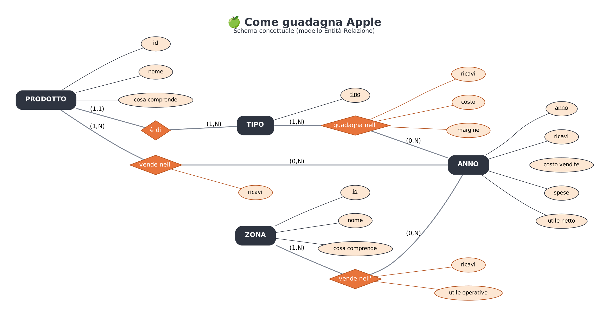
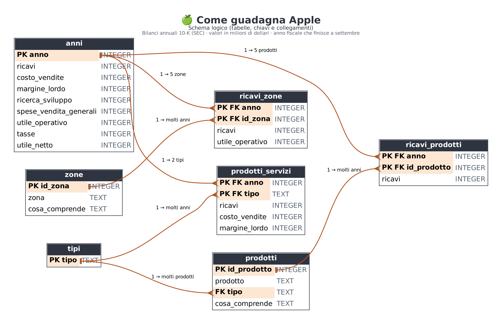

# 🍏 Come guadagna Apple (2010-2025)

Progetto di **Francesco Autorino** – Data Analyst.

🛠️ Strumenti: **SQL · Python · Power BI**

📊 Dati: i **16 bilanci annuali 10-K** che Apple consegna alla **SEC** (l'ente che controlla la Borsa americana), dal 2010 al 2025.

💵 Valori in **dollari** (nei grafici in miliardi).

📅 Anno = **anno fiscale** di Apple: finisce a fine settembre (2025 = ottobre 2024 → settembre 2025).

⚠️ È un'analisi dei conti dell'azienda, **non** un consiglio su azioni o investimenti.

---

## 🧭 1. Il progetto in breve

❓ **La domanda**: da dove arrivano i soldi di Apple, e come è cambiato in 15 anni?

Le 5 domande più piccole:

1️⃣ 📈 Quanto è cresciuta Apple dal 2010 a oggi?

2️⃣ 📱 Apple dipende ancora dall'iPhone?

3️⃣ ☁️ I Servizi (App Store, iCloud, Music…) stanno crescendo? Rendono di più?

4️⃣ 🌍 In quali zone del mondo vende? La Cina cresce o scende?

5️⃣ 💵 Su 100 dollari di ricavi, quanti restano ad Apple?

📌 **Ricavi** = tutto quello che Apple incassa vendendo.

📌 **Margine lordo** = quello che resta dopo aver pagato i costi per fare prodotti e servizi.

📌 **Utile netto** = quello che resta alla fine, dopo tutte le spese e le tasse.

---

## 🎯 2. I risultati principali

📈 I ricavi sono passati da **65** a **416 miliardi di $**: **6,4 volte** in 15 anni. Solo **3 anni** in calo (2016, 2019, 2023).

📱 L'**iPhone** porta ancora **metà** dei ricavi (**50,4%**). Il picco è stato nel **2015** (66%).

☁️ I **Servizi** sono cresciuti **6,8 volte** dal 2013: sono il **26%** dei ricavi ma il **42%** del margine lordo.

💎 Su 100 $ di Servizi restano **75 $** di margine; su 100 $ di Prodotti **37 $**.

🌍 **Americhe 43%**, **Europa 27%**. La **Grande Cina** è scesa dal **25%** (2015) al **15,5%** (2025).

💵 Su 100 $ di ricavi restano **27 $ di utile netto** (2025): il valore più alto dal 2010.

🔬 La **ricerca e sviluppo** è passata da **1,8** a **34,6 miliardi**: 19 volte.

---

## 🛠️ 3. Perché questi strumenti

🗄️ **SQL**: un database con 7 tabelle collegate e 18 query (JOIN, CTE, LAG, RANK, funzioni finestra).

🐍 **Python**: leggere i bilanci in formato XBRL, pulirli, controllarli e fare 8 grafici.

📊 **Power BI**: una dashboard pulita, in stile sito di prodotti, con i pulsanti per scegliere **prodotti** e **zone**.

---

## 🔄 4. Il percorso dei dati

```
SEC: 16 bilanci 10-K (XBRL) ─┐
SEC: companyfacts (controllo) ┴─► 01_scarica.py ─► 02_pulizia.py ─► ✅ 6 tabelle pulite ─┬─► 🗄️ SQL
                                  (1GrezziNonPuliti)                  (2Puliti)          ├─► 🐍 Python
                                                                                         └─► 📊 Power BI
```

🧹 **Cosa ho fatto durante la pulizia**

| Passo | Cosa | Risultato |
|---|---|---|
| 1 | Letti i 16 bilanci 10-K in formato XBRL | 8.050 numeri annuali |
| 2 | Cercati i doppioni con valore diverso | 34: 33 sono l'utile operativo scritto 2 volte (Apple intera e somma delle zone). Tengo Apple intera |
| 3 | Per ogni anno uso il **bilancio più recente** | Apple a volte sposta prodotti tra i gruppi e ricalcola gli anni passati |
| 4 | Controllo: ricavi − costo delle vendite = margine lordo | ✅ vero per tutti i 16 anni |
| 5 | Controllo: margine lordo − spese = utile operativo | ✅ vero per tutti i 16 anni |
| 6 | Controllo con la seconda fonte (companyfacts SEC) | 45 confronti, differenza 0 |
| 7 | Controllo: somma dei 5 prodotti = ricavi totali | ✅ dal 2013 al 2025 |
| 8 | Tolto il vecchio segmento "Retail" (negozi, fino al 2014) | dal 2015 Apple divide tutto in 5 zone: uso i dati ricalcolati così |
| 9 | Controllo: somma delle 5 zone = ricavi totali | ✅ dal 2013 al 2025 |

---

## 📁 5. I file in questo repository

| File | A cosa serve |
|---|---|
| `README.md` | Questo file |
| `DESCRIZIONE_GITHUB.md` | Nome, descrizione e topics del repository |
| `00_LEGGIMI.md` (in ogni cartella) | Una spiegazione corta di quella cartella |

### 📂 01SQL

| File | A cosa serve |
|---|---|
| `01_schema_concettuale.png` | 🧩 Lo schema concettuale (modello Entità-Relazione) |
| `02_schema_logico.png` | 🗂️ Lo schema logico: tabelle, chiavi PK/FK e collegamenti |
| `03_crea_database.sql` | 🏗️ Crea le 7 tabelle |
| `04_query_analisi.sql` | 🔍 **18 query** divise per domanda: JOIN, CTE, LAG, RANK, funzioni finestra |
| `05_apple_ricavi.db` | 🗄️ Il database SQLite già pronto (si apre con DB Browser for SQLite) |

🧩 **Schema concettuale**



🗂️ **Schema logico**



### 📂 02Python

| File | A cosa serve |
|---|---|
| `01_analisi_apple_ricavi.ipynb` | 📓 L'analisi completa con 8 grafici (si legge anche su GitHub) |
| `02_CONCLUSIONI.md` | ✅ Le risposte alle 5 domande |

### 📂 03PowerBi

| File | A cosa serve |
|---|---|
| `01_AppleRicaviDashboard.zip` | ⭐ **La dashboard**: estrai lo zip e apri `AppleRicavi_Dashboard.pbip` con Power BI Desktop |
| `02_AppleRicavi_Dashboard.pdf` | 📄 La dashboard in PDF |
| `03_misure_DAX.txt` | 🧮 Le 47 misure DAX |

📊 **Le 6 pagine della dashboard**

1. **Panoramica**: 6 numeri chiave, ricavi e utile netto, crescita anno per anno, ricavi 2025 per prodotto
2. **I prodotti**: ricavi e quota di iPhone, Mac, iPad, Accessori e Servizi
3. **I servizi**: margine di Prodotti e Servizi, il peso dei Servizi, iPhone e Servizi a confronto
4. **Le zone del mondo**: Americhe, Europa, Grande Cina, Giappone, Resto Asia-Pacifico
5. **Su 100 dollari**: dove vanno 100 $ di ricavi, margine, utile e ricerca
6. **Conclusioni**

🎛️ Nella pagina 2 si scelgono i **prodotti**, nella pagina 4 le **zone**.

🎨 Stile pulito, come il sito di un'azienda di prodotti: barra bianca, fondo grigio chiaro, schede bianche arrotondate, blu come colore principale.

---

## 📦 6. Dati e script

📌 Qui ci sono solo i **risultati**: database e query, analisi e dashboard.

📥 I dati si possono riscaricare dalla SEC (link più sotto).

🐍 Gli script Python di raccolta e pulizia dei dati sono disponibili su richiesta.

---

## ⚠️ 7. Limiti

📌 I 5 gruppi di prodotti e le 5 zone ci sono solo dal **2013**. I costi separati di Prodotti e Servizi solo dal **2017**.

📌 Apple a volte sposta prodotti da un gruppo all'altro: per ogni anno ho usato il bilancio più recente.

📌 L'**utile per zona** non comprende la ricerca e le spese centrali: serve per confrontare le zone, non è l'utile vero.

📌 Valori in dollari **non corretti per l'inflazione**.

📌 Il bilancio non dice **quanti pezzi** vende: Apple non lo pubblica più dal 2019.

📌 Nella dashboard non ci sono il logo Apple né foto dei prodotti: sono protetti.

---

## 🔗 8. Da dove arrivano i dati (link)

| Fonte | Cosa ho preso | Link |
|---|---|---|
| SEC – EDGAR, pagina di Apple | L'elenco di tutti i documenti di Apple (CIK 0000320193) | https://www.sec.gov/cgi-bin/browse-edgar?action=getcompany&CIK=0000320193&type=10-K |
| SEC – API submissions | L'elenco dei bilanci 10-K in formato JSON | https://data.sec.gov/submissions/CIK0000320193.json |
| SEC – API companyfacts | Tutti i numeri di bilancio, usati per il controllo | https://data.sec.gov/api/xbrl/companyfacts/CIK0000320193.json |
| SEC – Archivio EDGAR | I 16 bilanci 10-K in formato XBRL (2010-2025) | https://www.sec.gov/Archives/edgar/data/320193/ |
| SEC – Come usare le API | Le regole per scaricare i dati | https://www.sec.gov/search-filings/edgar-application-programming-interfaces |

📅 Dati scaricati il **27 ottobre 2026**.

---

## 🪜 9. Tutti i passaggi fatti, in ordine

1️⃣ **Scelta del progetto**: non il prezzo delle azioni, ma **come** Apple guadagna.

2️⃣ **Domande**: ho fissato le 5 domande e il periodo 2010-2025.

3️⃣ **Raccolta** (`01_scarica.py`): i 16 bilanci 10-K e companyfacts dalla SEC.

4️⃣ **Pulizia** (`02_pulizia.py`): conto economico, prodotti, zone, Prodotti e Servizi, con 6 controlli.

5️⃣ **SQL**: database SQLite con 7 tabelle, schema concettuale e logico, 18 query.

6️⃣ **Python**: notebook con 8 grafici e le conclusioni.

7️⃣ **Power BI**: dashboard di 6 pagine, aperta e controllata in Power BI Desktop.

8️⃣ **PDF**: esportata la dashboard in `AppleRicavi_Dashboard.pdf`.

9️⃣ **Conclusioni**: risposte alle 5 domande e limiti.
